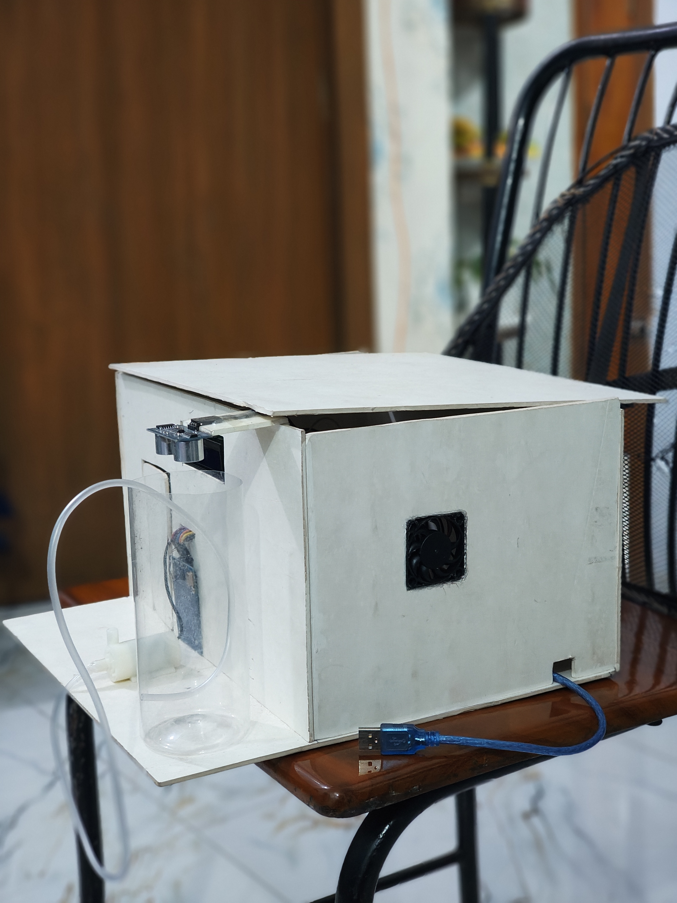
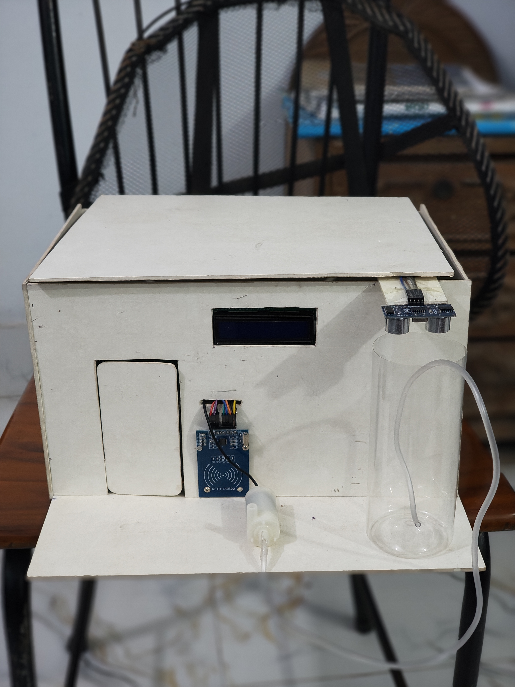

# Smart Home Automation and Security System (Arduino UNO)

<p align="center">
  
  
</p>

An Arduino UNO based smart-home prototype that combines three independent automations and a live status display:

| Subsystem | What it does |
|---|---|
| **Security** | RFID door lock. An authorized card moves a servo to unlock the door for 3 s, then it relocks. Any other card is rejected. |
| **Water management** | HC-SR04 ultrasonic sensor watches a water tank. Low level switches the pump **on**, full level switches it **off**. |
| **Climate control** | DHT11 sensor reads room temperature. At or above the threshold the fan turns **on**, below it turns **off**. |
| **Status display** | 16x2 I2C LCD shows the door status, temperature/fan state and water distance/pump state. Everything is also mirrored to the Serial Monitor. |

> Course project: **CSE382.6 - Introduction to Embedded Systems Lab, Section 06**, Department of CSE, Southeast University (Group F).

---

## Table of contents
1. [Hardware](#hardware)
2. [Pin map](#pin-map)
3. [Wiring and power](#wiring-and-power)
4. [Software setup](#software-setup)
5. [Configuration](#configuration)
6. [How it works](#how-it-works)
7. [Bring-up and testing](#bring-up-and-testing)
8. [Repository layout](#repository-layout)
9. [Known limitations](#known-limitations)
10. [Team](#team)
11. [License](#license)

---

## Hardware

| Qty | Component | Notes |
|---|---|---|
| 1 | Arduino UNO | |
| 1 | MFRC522 RFID reader + card/tag | **3.3 V only** - 5 V can damage it |
| 1 | SG90 micro servo | Door lock actuator |
| 1 | HC-SR04 ultrasonic sensor | Mounted above the tank, facing down |
| 1 | DHT11 temperature sensor | Digital, single-wire (not an LM35) |
| 2 | 5 V relay module (or one 2-channel) | One for the pump, one for the fan |
| 1 | 16x2 LCD with I2C backpack (PCF8574) | Address `0x27` in this build |
| 1 | Small DC water pump | |
| 1 | Small DC fan | |
| 1 | 5 V / 2 A DC adapter | Powers pump, fan and servo |
| - | Breadboard, jumper wires | Common ground for everything |

## Pin map

| Module | Module pin | Arduino pin |
|---|---|---|
| MFRC522 RFID | SDA / SS | D10 |
| | SCK | D13 |
| | MOSI | D11 |
| | MISO | D12 |
| | RST | D9 |
| | 3.3V / GND | 3.3V / GND |
| Servo (door) | Signal | D6 |
| DHT11 | DATA | D2 |
| Relay 1 (fan) | IN | D3 |
| Relay 2 (pump) | IN | D4 |
| HC-SR04 | Trig | D7 |
| | Echo | D8 |
| LCD (I2C) | SDA | A4 |
| | SCL | A5 |

Unused: D5 and A0-A3 (D0/D1 are reserved for serial).

Full wiring detail and diagrams: **[docs/wiring.md](docs/wiring.md)**.

## Wiring and power

Three points matter more than the rest:

1. **Servo power and ground.** The servo is powered from the external 5 V adapter, not the Arduino 5 V pin (the Arduino cannot supply the current spike once the RFID reader, relays and sensors are also running). Its signal wire stays on D6, and **the adapter GND must be tied to the Arduino GND** - without a shared ground the servo ignores the signal.
2. **Relays switch the pump and fan.** They are driven from the Arduino, but their load side (COM / NC) is powered from the external adapter.
3. **RFID runs on 3.3 V.** Keep the reader's supply pin on the UNO's 3.3 V output, never 5 V. (Its SPI signal pins are driven directly by the UNO's 5 V logic, which is common in hobby builds but outside the chip's rated limits - see [Known limitations](#known-limitations).)

### Relay behaviour in this build
The relay modules used here are **active-LOW**, and the pump and fan are wired to **COM / NC**. The firmware therefore writes `HIGH` to switch a load **on** (coil off -> COM connects to NC) and `LOW` to switch it **off**. If your relay module is active-HIGH, or you wire the load to NO instead, swap the `HIGH`/`LOW` values in `checkTemperature()`, `checkWaterLevel()` and in `setup()`. See [docs/wiring.md](docs/wiring.md#relay-wiring-comnonc) for details and a safety note.

## Software setup

1. Install the **[Arduino IDE](https://www.arduino.cc/en/software)** (2.x or 1.8.x).
2. Install libraries via *Sketch -> Include Library -> Manage Libraries*:

   | Library | Author |
   |---|---|
   | `MFRC522` | GithubCommunity |
   | `DHT sensor library` (+ `Adafruit Unified Sensor`) | Adafruit |
   | `LiquidCrystal I2C` | Frank de Brabander |
   | `Servo`, `SPI`, `Wire` | built in |

3. Clone the repo and create your private config:
   ```bash
   git clone https://github.com/<your-username>/smart-home-automation-arduino.git
   cd smart-home-automation-arduino/firmware/smart_home_system
   cp config.example.h config.h      # then edit config.h
   ```
4. Open `firmware/smart_home_system/smart_home_system.ino`, select **Board: Arduino Uno** and your **Port**, click **Upload**.
5. Open the Serial Monitor at **9600 baud**.

## Configuration

All tunable values live in `firmware/smart_home_system/config.h` (copied from `config.example.h`). `config.h` is git-ignored so your real card UID is never published.

| Setting | Default | Meaning |
|---|---|---|
| `authorizedUID` | `DE AD BE EF` (placeholder) | UID of the card allowed to open the door |
| `LOCK_ANGLE` / `UNLOCK_ANGLE` | `0` / `90` | Servo positions in degrees |
| `TEMP_THRESHOLD` | `31.0` | Fan turns on at or above this temperature (deg C) |
| `LOW_THRESHOLD_CM` | `13.0` | Distance to water >= this -> tank low -> pump on |
| `FULL_THRESHOLD_CM` | `3.0` | Distance to water <= this -> tank full -> pump off |
| `LCD_I2C_ADDR` | `0x27` | Find yours with `tests/i2c_scanner` (often `0x27` or `0x3F`) |

**Finding your card UID:** upload `firmware/tests/rfid_only_test`, scan the card, and copy the bytes printed after `Scanned UID:` into `authorizedUID`.

## How it works

```text
loop()
 |-- checkRFID()        every pass   -> read card, compare UID, drive servo + LCD row 0
 |-- checkTemperature() every 1 s    -> DHT11 read, fan on/off
 |-- checkWaterLevel()  every 0.5 s  -> HC-SR04 read, pump on/off with hysteresis
 `-- updateLCDRow1()    every 2 s    -> alternate: temp/fan  <->  distance/pump
```

- **Non-blocking timing.** The sensors use `millis()` timers instead of `delay()`, so the RFID reader keeps polling while temperature and water are measured. (The only intentional pause is the 3 s the door stays unlocked.)
- **Pump hysteresis.** Between the two thresholds (3-13 cm) the pump keeps its previous state, so it does not chatter around a single value.
- **Fan.** On at or above `TEMP_THRESHOLD`, off below it. The DHT11 is read at most once per second, as it requires.
- **LCD.** Row 0 shows `Scan Your Card`; on a scan it briefly shows `Welcome Boss` (authorized) or `Wait a minute.` / `Who are you?` (rejected, using both rows because the message is longer than 16 characters). Row 1 alternates between `T:xx.xC F:ON/OFF` and `Dist:xxcm P:ON/OFF`.

### Serial Monitor output (example)
```text
RFID version check: Firmware Version: 0x92 = v2.0
System ready. Scan a card...
Temp: 29.00 C | Fan: OFF
Distance: 15 cm | Pump: ON
Scanned UID: DE AD BE EF
Access Granted -> door unlocking
Door locked again
```

## Bring-up and testing

Build and verify one subsystem at a time, then combine. Each test is a standalone sketch in `firmware/tests/`:

| Step | Sketch | Passes when |
|---|---|---|
| 1 | `rfid_only_test` | Version prints `0x91`/`0x92`; scanning the authorized card moves the servo |
| 2 | `dht11_fan_test` | Temperature prints; the fan relay switches at the threshold |
| 3 | `ultrasonic_pump_test` | Distance prints; the pump relay switches at 13 cm / 3 cm |
| 4 | `i2c_scanner` | Prints the LCD address |
| 5 | `lcd_block_test` | Both LCD rows fill with solid blocks (confirms wiring/contrast) |
| 6 | `smart_home_system` | All of the above work together |

Hit a problem? See **[docs/troubleshooting.md](docs/troubleshooting.md)**.

## Repository layout

```text
smart-home-automation-arduino/
|-- README.md
|-- LICENSE
|-- .gitignore
|-- docs/
|   |-- wiring.md              pin map, power and relay wiring, diagrams
|   `-- troubleshooting.md     problems we hit while building, and the fixes
`-- firmware/
    |-- smart_home_system/     the complete system
    |   |-- smart_home_system.ino
    |   `-- config.example.h   copy to config.h (git-ignored)
    `-- tests/                 one standalone sketch per module
        |-- rfid_only_test/
        |-- dht11_fan_test/
        |-- ultrasonic_pump_test/
        |-- i2c_scanner/
        `-- lcd_block_test/
```

Arduino requires each sketch to live in a folder with the same name as its `.ino` file, which is why every test has its own directory.

## Known limitations

- **Fail-safe state.** With the loads wired to NC on active-LOW relays, the pump and fan are *powered* whenever the Arduino is unpowered or resetting. For a fail-safe-off design, wire the loads to NO and invert the relay logic.
- **Single authorized card.** One UID is compiled in; supporting several cards or adding/removing them at runtime would need an array of UIDs or EEPROM storage.
- **Card security.** A UID alone is weak authentication - many MIFARE tags can be cloned. Fine for a lab demo, not for a real lock.
- **Door delay blocks the loop.** For the 3 s the door is unlocked, `delay(3000)` pauses the temperature, water and display updates.
- **DHT11 accuracy.** About +/-2 deg C and 1 Hz sampling.
- **Ultrasonic reads.** Distance is a single reading without filtering; ripples or foam can cause spurious values. A median of several samples would be more robust.
- **RFID logic levels.** The MFRC522 is a 3.3 V part; this build feeds it the UNO's 5 V SPI signals directly. It works, but a level shifter or resistor dividers on SCK/MOSI/SS/RST is the proper design.
- **Not tested on real mains loads.** This build uses a low-voltage 5 V DC pump and fan only.

## Team

**Group F** - CSE382.6, Section 06, Southeast University

- Shahariar Mahmud
- Md. Anas Ahamed Sarker
- Sameha Binte Chowdhury

## License

Released under the [MIT License](LICENSE).
