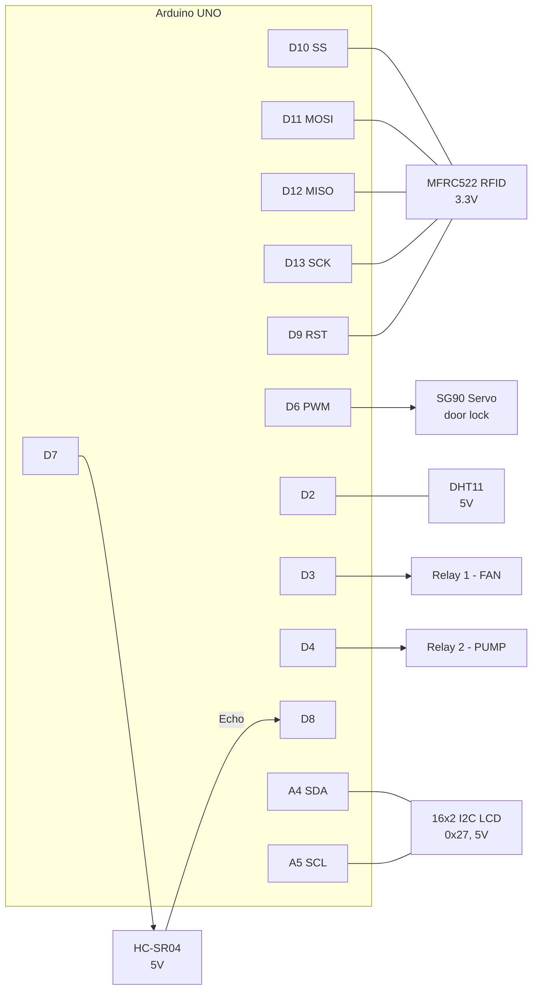
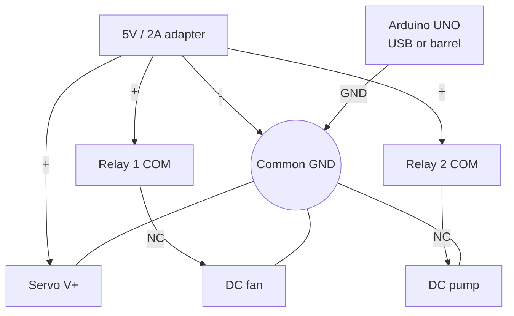

# Wiring guide

Everything shares one ground. Power the high-current parts (servo, pump, fan) from the external 5 V / 2 A adapter, not from the Arduino.

## Block diagram

## Power architecture

Key rule: **Arduino GND, adapter GND, servo GND and relay-module GND are all connected.** The servo's signal wire is read relative to the Arduino ground; if the grounds are not tied together the servo will not respond.

## Module by module

### MFRC522 RFID reader
| Reader pin | Arduino |
|---|---|
| SDA (SS) | D10 |
| SCK | D13 |
| MOSI | D11 |
| MISO | D12 |
| RST | D9 |
| IRQ | not connected |
| 3.3V | 3.3V |
| GND | GND |

Supply it from **3.3 V**. MOSI and MISO are easy to swap - if the startup line prints a version other than `0x91`/`0x92`, check them first, then your solder joints.

### SG90 servo (door lock)
| Servo wire | Connect to |
|---|---|
| Signal (orange/yellow) | Arduino D6 |
| V+ (red) | external 5 V adapter (+) |
| GND (brown/black) | adapter (-) **and** Arduino GND |

No relay is needed: the servo is positioned by a PWM signal, not switched on and off.

### DHT11 temperature sensor
| DHT11 pin | Arduino |
|---|---|
| DATA | D2 |
| VCC | 5V |
| GND | GND |

A 3-pin DHT11 module already contains the pull-up resistor. A bare 4-pin sensor needs a 10 kOhm resistor between DATA and VCC.

### HC-SR04 ultrasonic sensor
| HC-SR04 pin | Arduino |
|---|---|
| Trig | D7 |
| Echo | D8 |
| VCC | 5V |
| GND | GND |

Mount it above the tank, pointing straight down at the water surface. The reading is the distance from the sensor to the water, so it **gets smaller as the tank fills**.

### I2C LCD (16x2)
| LCD pin | Arduino |
|---|---|
| SDA | A4 |
| SCL | A5 |
| VCC | 5V |
| GND | GND |

### Relay control side
| Relay module | Arduino |
|---|---|
| Relay 1 (fan) IN | D3 |
| Relay 2 (pump) IN | D4 |
| VCC | 5V |
| GND | GND |

## Relay wiring (COM/NO/NC)

Each relay's load side switches the **positive** wire of the pump or fan. Only one wire goes through the relay; the load's negative goes straight back to the adapter.

As built:

| Relay terminal | Connects to |
|---|---|
| COM | adapter (+) |
| NC | pump / fan (+) |
| NO | unused |

Load (-) goes directly to adapter (-).

### Why NC?
The relay modules used here are **active-LOW**: driving the IN pin `HIGH` leaves the coil *off*, and driving it `LOW` energizes it. With the load on **NC**, power flows when the coil is *off*, so the firmware's `HIGH` = "load on" matches the physical behaviour:

| Firmware writes | Relay coil / LED | COM connects to | Load |
|---|---|---|---|
| `HIGH` | off | NC | **ON** |
| `LOW` | on | NO | **OFF** |

Relay modules vary. If yours is **active-HIGH**, or you would rather wire the load to NO, either change the wiring or swap `HIGH`/`LOW` in the sketch. The reliable check is behavioural: whichever terminal makes the device run when Serial Monitor says `ON` is right for your board.

> **Safety / fail-safe note.** With NC wiring on an active-LOW module, the loads run whenever the Arduino is unpowered or resetting. For a fail-safe-off design use NO and invert the logic. This project uses only a low-voltage DC pump and fan; do not adapt it to mains-powered loads unless you are qualified to work with mains wiring.

## Pin summary

| Arduino pin | Used for |
|---|---|
| D2 | DHT11 data |
| D3 | Fan relay IN |
| D4 | Pump relay IN |
| D6 | Servo signal |
| D7 | HC-SR04 Trig |
| D8 | HC-SR04 Echo |
| D9 | RFID RST |
| D10 | RFID SS |
| D11 | RFID MOSI |
| D12 | RFID MISO |
| D13 | RFID SCK |
| A4 | LCD SDA |
| A5 | LCD SCL |
| 3.3V | RFID supply |
| 5V | DHT11, HC-SR04, LCD, relay logic |
